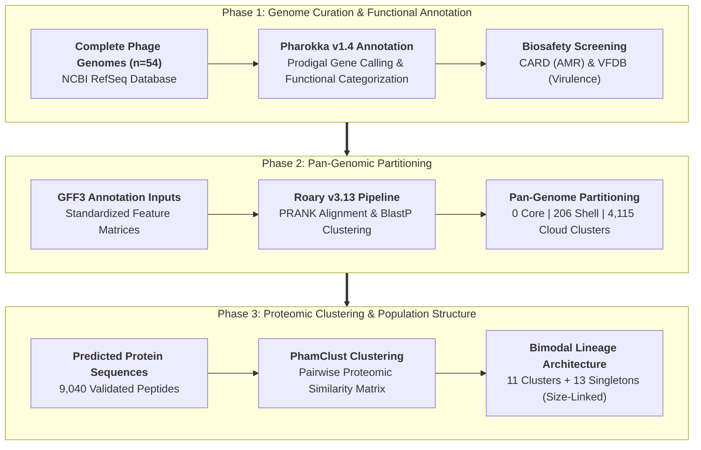

# Comparative Pan-Genomic and Functional Analysis of *Shigella* Bacteriophages Reveals a Fragmented, Genome Size-Linked Population Structure

**Author(s):** Md Abu Sadat Soash  
*Department of Genetic Engineering and Biotechnology*<br>
*Shahjalal University of Science and Technology, Sylhet, Bangladesh*

[-blue.svg)](https://www.ncbi.nlm.nih.gov/refseq/)
[](https://github.com/jmcvist/pharokka)
[](https://sanger-pathogens.github.io/Roary/)
[](https://github.com/)
[](https://card.mcmaster.ca/)

---

## Abstract

* **Objective:** *Shigella* species are a leading etiology of bacillary dysentery (shigellosis) in low- and middle-income countries, where the alarming escalation of multidrug-resistant (MDR) strains severely compromises antibiotic therapy. Bacteriophages represent a promising alternative therapeutic paradigm. However, the genomic architecture, pan-genomic diversity, and biosafety profiles of known *Shigella* phages have not been comprehensively established.
* **Methodology:** We retrieved 54 complete *Shigella* phage genomes from the NCBI RefSeq database. Gene models and functional categories were systematically annotated using **Pharokka**, followed by targeted virulence factor (VFDB) and antimicrobial resistance gene (**CARD**) screening. Pan-genome partitioning was performed with **Roary**, and whole-proteome similarity clustering was resolved using **PhamClust**.
* **Findings:** The *Shigella* phage pan-genome comprises **4,321 gene clusters** characterized by an extreme open architecture with **0 core genes** shared across all 54 genomes, 206 shell gene clusters (4.8%), and 4,115 cloud gene clusters (95.2%). Of 9,040 predicted coding sequences, DNA/RNA metabolism (13.9%) and virion structural/tail proteins (9.0%) constituted the primary annotated categories, while 54.6% represented uncharacterized hypothetical proteins. Zero antimicrobial resistance determinants were detected, confirming preliminary biocontrol safety, though two temperate phages carried *gtrA/gtrB/gtr*-type O-antigen serotype-converting enzymes. PhamClust partitioned the population into **11 distinct clusters and 13 singletons**, driven primarily by bimodal genome size separation (165–194 kb large-genome vs. ~50 kb small-genome clades).
* **Implications:** *Shigella* bacteriophages do not form a monophyletic or uniform population, but rather a fragmented assemblage of size-linked lineages with high genomic mosaicism. Rational phage cocktail design against *Shigella* must combine distinct genomic clusters to ensure therapeutic coverage and prevent rapid resistance emergence.

---

## 1. Introduction & Biological Background

Bacillary dysentery (shigellosis), caused by *Shigella* species (*S. flexneri*, *S. sonnei*, *S. dysenteriae*, and *S. boydii*), causes hundreds of thousands of deaths annually, predominantly among children under five in developing nations including Bangladesh. The progressive loss of efficacy across first-line and second-line therapeutics (including fluoroquinolones, macrolides, and third-generation cephalosporins) has propelled the World Health Organization to prioritize *Shigella* as an urgent global antimicrobial resistance threat.

```
                  Shigellosis Pathogen Pressure
                                │
                 ┌──────────────┴──────────────┐
                 ▼                             ▼
       Antibiotic Inefficacy &        Severe Dysentery Burden
     Multidrug Resistance (MDR)       in Resource-Limited LMICs
                 │                             │
                 └──────────────┬──────────────┘
                                ▼
               Phage Biocontrol & Lytic Therapy
                                │
                 ┌──────────────┴──────────────┐
                 ▼                             ▼
       High Genomic Mosaicism &       Biosafety Screening:
     Bimodal Genome Size Lineages     Absence of AMR Genes /
       (Large vs Small Phages)       Serotype-Converting gtr
                                │
                                ▼
             Rational Multivalent Cocktail Formulation
```

1. **Phage Therapy as an AMR Countermeasure:** Bacteriophages selectively target bacterial host receptors without disrupting protective host gut commensals. However, therapeutic success requires selecting purely lytic phages that are entirely devoid of lysogenic transfer mechanisms and antibiotic resistance genes.
2. **The Pangenomic Disconnect in Phage Biology:** Phages undergo frequent illegitimate recombination and horizontal module swapping. Treating *Shigella* phages as a homogenous pool overlooks substantial divergence in genome lengths, replication machinery, and host-range determinants.
3. **Study Aims:** This study establishes a rigorous comparative genomic baseline across 54 complete RefSeq genomes, systematically resolving pangenome fluidity, virion proteomic similarity, and functional safety attributes.

---

## 2. Genomic Dataset & Cohort Stratification

Fifty-four complete, closed bacteriophage genomes infecting *Shigella* hosts were curated from the **NCBI RefSeq** repository, ensuring high assembly continuity:

| Dataset Metric | Verified Statistic | Analytical Significance |
| :--- | :---: | :--- |
| **Total Analyzed Genomes** | **54** | Complete RefSeq circular/linear phage assemblies |
| **Predicted Coding Sequences (CDS)** | **9,040** | Total open reading frames called via Prodigal/Pharokka |
| **Genome Size Range** | **37.5 kb – 194.2 kb** | Broad structural bimodal size variation |
| **G+C Content Range** | **38.2% – 52.8%** | Divergence reflecting distinct host adaptation histories |
| **Antimicrobial Resistance (CARD)** | **0 genes (0.0%)** | Clean safety profile for therapeutic candidate selection |
| **Virulence / Serotype Genes** | **2 genomes** | *gtrA/gtrB/gtr* O-antigen serotype modification loci |

---

## 3. Computational Pipeline Architecture



---

## 4. Key Scientific Findings & Comparative Analysis

### 4.1 Extreme Pan-Genomic Openness & Cloud Dominance

Partitioning the 4,321 orthologous gene clusters revealed that the *Shigella* phage population possesses an entirely open pan-genome devoid of a universally conserved core:

| Pangenome Partition | Cluster Count | Proportion of Pangenome (%) | Functional & Evolutionary Implication |
| :--- | :---: | :---: | :--- |
| **Core Genome ($\ge 99\%$)** | **0** | **0.00%** | Absolute absence of universally shared genes across the 54 phages |
| **Soft Core ($95\% - 99\%$)** | 0 | 0.00% | No gene family conserved across 95% of isolates |
| **Shell Genome ($15\% - 95\%$)** | 206 | 4.77% | Moderately conserved replication, baseplate, and structural modules |
| **Cloud Genome ($< 15\%$)** | **4,115** | **95.23%** | Vast accessory reservoir driving strain-specific host adaptation |
| **Total Pan-Genome** | **4,321** | **100.0%** | Highly dynamic, recombinogenic genetic architecture |

### 4.2 Functional Annotation & Proteomic Categories

Functional categorization of the 9,040 predicted coding sequences demonstrated that more than half of the proteome represents uncharacterized biology:

```
                  Predicted Coding Sequences (n = 9,040)
                                    │
       ┌────────────────────────────┼────────────────────────────┐
       ▼                            ▼                            ▼
Unannotated / Hypothetical     DNA & RNA Metabolism         Structural & Tail
     (54.6%, n=4,936)            (13.9%, n=1,257)            (9.0%, n=814)
       │                            │                            │
       • Phage dark matter          • Helicases & Primases       • Baseplate wedges
       • Novel auxiliary genes      • DNA polymerases & Ligases  • Contractile tails
```

* **DNA / RNA Metabolism (13.9%):** Enzymes essential for rapid autonomous phage replication, including DNA helicases, nucleotide kinases, and single-stranded DNA-binding proteins.
* **Morphology & Tail Assembly (9.0%):** Structural components conferring bacterial outer membrane receptor recognition (LPS and outer membrane proteins like OmpA/OmpC).
* **Transcription & Host Hijacking (4.1%):** Transcriptional modulators and anti-restriction proteins shielding phage DNA from host restriction-modification systems.
* **Unannotated Sequences (54.6%):** A massive proportion of uncharacterized hypothetical proteins highlights the vast "viral dark matter" remaining to be experimentally characterized.

### 4.3 Population Structure & Genome-Size-Linked Clustering

Whole-proteome clustering via **PhamClust** grouped the 54 genomes into **11 distinct clusters and 13 singleton genomes**, with structural clustering tracking closely with total genome length:

```
                           PhamClust Population Separation
                                          │
                  ┌───────────────────────┴───────────────────────┐
                  ▼                                               ▼
         Cluster 1: Myoviridae Clade                     Cluster 2: Small Podophages /
          (Large Genomes: 165–194 kb)                            Siphophages
          ──────────────────────────                      (Small Genomes: ~50 kb)
          • 12 complete genomes                           ───────────────────────────
          • Autonomous replisome                          • 7 complete genomes
          • Broad host-range machinery                    • Dependent on host replisome
```

* **Cluster 1 (Large-Genome Group, 12 Phages):** Ranging from 165 kb to 194 kb (typical of T4-like *Myoviridae*), encoding autonomous replisomes, broad tail-fiber complexes, and metabolic auxiliary genes.
* **Cluster 2 (Small-Genome Group, 7 Phages):** Clustered near ~50 kb (typical of *Podoviridae* and *Siphoviridae*), characterized by compact genomes reliant on host enzymatic machinery.
* **Singletons & Distinct Clades (13 Genomes):** Highly divergent isolates representing unique ecological niches and distinct bacterial host species (*S. flexneri* vs. *S. sonnei*).

### 4.4 Biosafety Evaluation: Virulence & Resistance Determinants

* **Antimicrobial Resistance Genes (ARGs):** Querying against CARD yielded **zero confirmed resistance determinants**, confirming that these phages do not risk transducing antibiotic resistance into clinical bacterial populations.
* **Lysogenic Conversion Factors:** Two phages encoded *gtrA*, *gtrB*, and *gtr* glycosyltransferase family genes. These proteins mediate O-antigen glucosylation, a well-characterized serotype conversion mechanism in *Shigella flexneri* that can promote immune evasion. Such temperate phages must be filtered out when formulating lytic therapeutic cocktails.

---

## 5. Repository Organization

```text
shigella-phage-pangenome/
├── data/                                                            # Genomic data assets and metadata
│   ├── genomes_refseq_metadata.tsv                                  # Complete RefSeq accession and size table
│   └── functional_categories_summary.tsv                            # Pharokka functional category counts
├── results/                                                         # Pan-genome and clustering outputs
│   ├── roary_pangenome_matrix.tsv                                   # Gene presence/absence matrix (4,321 clusters)
│   ├── phamclust_cluster_assignments.tsv                           # 11 clusters & 13 singletons mapping
│   └── card_vfdb_screening_hits.tsv                                 # AMR & virulence factor screening audit
├── HealthBiomedical_SUST_MdAbuSadatSoash_BookofAbstractFormat.docx  # Full conference abstract draft
├── .gitignore                                                       # Environment ignore rules
└── README.md                                                        # Comprehensive project documentation
```

---

## 6. Execution, Reproducibility & Environment Setup

### 6.1 Computational Prerequisites
* Python 3.10+
* Conda / Mamba
* Bioinformatic Tools: `pharokka`, `roary`, `prokka`, `blast`

### 6.2 Step-by-Step Pipeline Execution
```bash
# 1. Clone repository
git clone https://github.com/Soash/shigella-phage-pangenome.git
cd shigella-phage-pangenome

# 2. Create conda environment
conda create -n phage_pangenome -c conda-forge -c bioconda pharokka roary
conda activate phage_pangenome

# 3. Execute annotation and biosafety screening
pharokka.py -i genomes/ -o results/pharokka/ -d databases/pharokka/

# 4. Perform pan-genome partitioning with Roary
roary -f results/roary/ -e --mafft -p 8 results/pharokka/*.gff

# 5. Execute whole-proteome clustering with PhamClust
phamclust -i results/pharokka/proteins/ -o results/phamclust/ --threshold 0.5
```

---

## 7. Authorship & Correspondence

If you use this comparative genomic framework, annotations, or clustering results, please cite:

> **Md Abu Sadat Soash** (2026). *Comparative Pan-Genomic and Functional Analysis of Shigella Bacteriophages Reveals a Fragmented, Genome Size-Linked Population Structure.* Department of Genetic Engineering and Biotechnology, Shahjalal University of Science and Technology, Sylhet, Bangladesh.  
> GitHub: [https://github.com/Soash/shigella-phage-pangenome](https://github.com/Soash/shigella-phage-pangenome)

### Inquiries
- **Md Abu Sadat Soash** — Department of Genetic Engineering and Biotechnology, Shahjalal University of Science and Technology, Sylhet, Bangladesh
- **Email:** [mdabu13@student.sust.edu](mailto:mdabu13@student.sust.edu)

---

## 8. References & Data Availability

1. **NCBI RefSeq Repository:** Complete phage genomes available via [NCBI Nucleotide](https://www.ncbi.nlm.nih.gov/refseq/).
2. **Pharokka Annotation Engine:** Bouras, G., et al. (2023). *Pharokka: a fast and easy-to-use pipeline for the annotation of bacteriophage genomes.* **Bioinformatics**, 39(1), btac776.
3. **Roary Pan-Genome Pipeline:** Page, A. J., et al. (2015). *Roary: rapid large-scale prokaryote pan genome analysis.* **Bioinformatics**, 31(22), 3691–3693.
4. **CARD Database:** Alcock, B. P., et al. (2023). *CARD 2023: expanded curation, support for machine learning, and resistome prediction at the Comprehensive Antibiotic Resistance Database.* **Nucleic Acids Research**, 51(D1), D690–D699.
5. **VFDB:** Liu, B., et al. (2022). *VFDB 2022: a general classification scheme for bacterial virulence factors.* **Nucleic Acids Research**, 50(D1), D912–D917.
